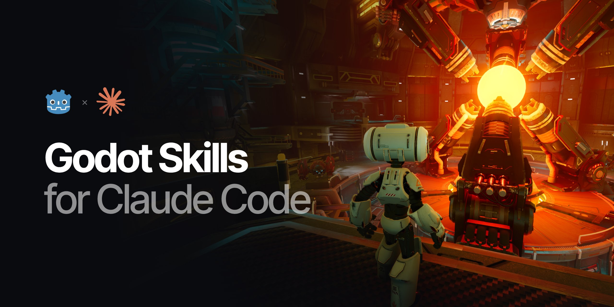

# godot-claude-code-skills

[中文](README.md) | English

[](https://github.com/MindsMaster/godot-claude-code-skills/actions/workflows/check.yml)
[](https://godotengine.org/)
[](LICENSE)
[](https://discord.invite.azuramc.cc/)

A Claude Code plugin for Godot 4 with 16 skills. It directs Claude Code to the nodes, resources and project settings built into the engine and away from common misuse. Covers 2D, 3D, UI, animation, audio, data, shaders, editor extensions and headless testing, in GDScript and C#.

# Example

Skills load automatically from the request; there is no need to name one. Given the following request:

> Add a follow camera to the player. Smooth follow, never show anything outside the level, shake on damage. The player respawns at a checkpoint after falling into a pit, and the camera must be in place the moment the player respawns.

With `godot-2d` loaded, the implementation:

- Enables `position_smoothing_enabled` on `Camera2D` and bounds it to the level with `limit_*`
- Shakes through `offset`, with noise from `FastNoiseLite`
- Calls `reset_smoothing()` immediately after setting `global_position` in the respawn code

Other cases:

| Task | Built-in solution |
| --- | --- |
| Tile levels and digging | `TileMapLayer`, `TileSet` terrains, `set_cells_terrain_connect` |
| Designer-editable stat tables | Custom `Resource` saved as `.tres`, external sheets converted at import time |
| Health bar and HUD | `ProgressBar`, Container layout, project-wide `Theme` |
| 2D characters in a 3D scene | `Sprite3D` billboard with `alpha_cut` shadows |
| Ducking music under dialogue | `AudioEffectCompressor` on the bus with `sidechain` set to Voice |
| Per-enemy hit flash on a shared material | `instance uniform` with `Tween` |

# Verification

- API: every class and member name in the text is checked against the class reference in the Godot engine source
- GDScript: every example runs in Godot 4.7.2, described behavior is verified with assertions, and rendering examples are rendered with software Vulkan and verified by reading pixels
- C#: every example compiles against Godot.NET.Sdk 4.7.2
- CI: all checks run on every push

Targets the latest stable release, 4.7.2, and supports 4.4 and later. APIs added in 4.5 or later are marked with their version.

The skill text is written in Chinese. Claude Code reads it directly and responds in the user's language. Code and identifiers are in English.

# Evaluation

Each case in `evals/` poses a development task and runs with and without the plugin installed. Regex assertions and an LLM judge check whether the built-in solution is used and whether the result holds in the engine. A run passes when every check passes.

October 2026, Claude Code 2.1.309 with its default model. 3 runs per condition; the headless case was rerun 6 times after a skill revision:

| Task | With | Without | Reason for failure |
| --- | --- | --- | --- |
| Follow camera and respawn | 3/3 | 0/3 | Infers teleports by comparing camera displacement every frame instead of calling `reset_smoothing()` at respawn |
| Volume settings and ducking music under dialogue | 3/3 | 1/3 | Polls the Voice bus peak every frame and adjusts music volume from script |
| C# hit flash on a shared material | 3/3 | 1/3 | Shader resamples `TEXTURE` instead of using `COLOR`, which already includes modulate |
| Pixel-art character in a 3D scene | 3/3 | 1/3 | Texture pixels not read; the character's feet float 1 pixel above the ground |
| Designer data and export | 3/3 | 2/3 | `waves.csv` not switched to the keep importer, so the exported build cannot read it |
| Tile level and digging | 3/3 | 0/3 | Recomputes neighbors with the ground terrain after digging, so neighboring tiles do not update |
| HUD and unified font | 3/3 | 0/3 | `.tscn` lacks `node_paths`, so the exported player reference is null at runtime |
| Headless fixing of script errors and warnings | 6/6 | 2/6 | No warnings reported without enabling warning output |
| Total | 27/27 | 7/27 | |

To reproduce:

```
claude plugin eval . --scaffold --trust-plugin --allow-tools Edit Write Bash
```

Granting Bash requires `bubblewrap` and `socat`. The headless case copies the Godot executable from `GODOT_BIN` or `godot` on PATH.

# Contents

| skill | Scope |
| --- | --- |
| `godot-builtin-first` | Entry point; looks for a built-in solution before writing a feature and routes to the specific skill |
| `godot-scene-architecture` | Scene composition, node references, signals, groups, autoloads, state machines, lifecycle |
| `godot-gdscript` | Static typing, annotations, signals and await, warning settings |
| `godot-csharp` | Name mapping, source generators, StringName caching, lifecycle, hot reload |
| `godot-2d` | CharacterBody2D, TileMapLayer, Camera2D, Parallax2D, pixel art, 2D lighting |
| `godot-3d` | CharacterBody3D, physics engines, lighting and GI, import pipeline, LOD, skeleton modifiers |
| `godot-2d-in-3d` | Sprite3D billboards, alpha cut and shadows, SubViewport, HD-2D post-processing |
| `godot-ui` | Container layout, Theme, health bars, RichTextLabel, stretch modes, localization |
| `godot-animation` | AnimationPlayer, AnimationTree, Tween, SpriteFrames, deterministic playback |
| `godot-input` | InputMap actions, gamepads, deadzones, persisting rebinds |
| `godot-audio` | Bus layout, volume settings, AudioStreamRandomizer, polyphony, dynamic music |
| `godot-resources-data` | Custom Resources, threaded loading, save data, import-time baking, built-in curve resources |
| `godot-shaders-vfx` | Shader parameters, instance uniforms, particles, Environment, post-processing, CompositorEffect |
| `godot-editor-tooling` | @tool, EditorPlugin, Inspector plugins, import plugins, undo, shortcuts |
| `godot-headless-testing` | Headless command line, smoke scenes, exit codes, CI, GUT, gdUnit4 |
| `godot-performance` | Profiler and Monitors, MultiMesh, physics interpolation, WorkerThreadPool, shader compilation stutter |

# Installation

Enabling the plugin per Godot project is recommended. At user scope, the 16 skill descriptions, about 7700 characters in total, enter the context of every turn in every project. Skill bodies load only when invoked.

Install at project scope from the Godot project directory:

```
claude plugin marketplace add MindsMaster/godot-claude-code-skills
claude plugin install godot-skills@godot-claude-code-skills --scope project
```

Omit `--scope project` to install at user scope.

To enable it for all members of a project, commit `.claude/settings.json` in that project:

```json
{
  "extraKnownMarketplaces": {
    "godot-claude-code-skills": {
      "source": {
        "source": "github",
        "repo": "MindsMaster/godot-claude-code-skills"
      }
    }
  },
  "enabledPlugins": {
    "godot-skills@godot-claude-code-skills": true
  }
}
```

It takes effect once a member opens the project and trusts the folder.

The marketplace must be added from the Git repository. When only the `marketplace.json` URL is given, the plugin's relative path `"source": "."` cannot be resolved.

# Updating

The plugin has no version number; each commit is a release. Third-party marketplaces do not auto-update by default. Choose one of the following:

- Manual: run `claude plugin update godot-skills@godot-claude-code-skills`, or open `/plugin` in a session, select the plugin under Installed and click Update now
- Automatic: open `/plugin` in a session, select `godot-claude-code-skills` under Marketplaces and click Enable auto-update. Updates are then checked within 10 minutes after the first message of each session

Run `/reload-plugins` or restart the session to apply an update.

# Contributing

Issues and pull requests are welcome. When reporting a mismatch between a skill and engine behavior, include the Godot version and a minimal reproduction.

Authoring rules are in `CLAUDE.md`. For local development, run `claude plugin marketplace add ./godot-claude-code-skills` against a local clone; each session reads the current files on startup.

Run the full test suite before submitting a pull request:

```
GODOT_BIN=/path/to/godot DOTNET_BIN=/path/to/dotnet python3 tests/check.py
```

The suite runs lint, api, gd, run and cs in order. run executes each GDScript example; the scenes, resources and calls an example requires are defined in the fixture file `tests/run/<skill>.md`. Error or warning output, failed assertions and timeouts count as failures. Rendering examples require `xvfb-run` and a Vulkan driver; install `mesa-vulkan-drivers` on machines without a GPU. See `tests/README.md` for details.

# Community

- Discord: <https://discord.invite.azuramc.cc/>
- QQ group: 1046048297

# License

MIT. See `LICENSE`.

Third-party material in the banner:

- Background: screenshot of the Godot demo [tps-demo](https://github.com/godotengine/tps-demo) by Juan Linietsky and Fernando Miguel Calabró, licensed under [CC BY 3.0](https://creativecommons.org/licenses/by/3.0/). Cropped, with a gradient overlay
- Godot logo: by Andrea Calabró, licensed under [CC BY 4.0](https://creativecommons.org/licenses/by/4.0/)
- Claude logo: a trademark of Anthropic

This project is not affiliated with Anthropic or the Godot Foundation.
